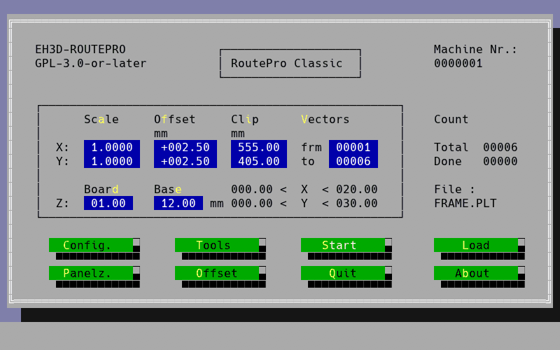
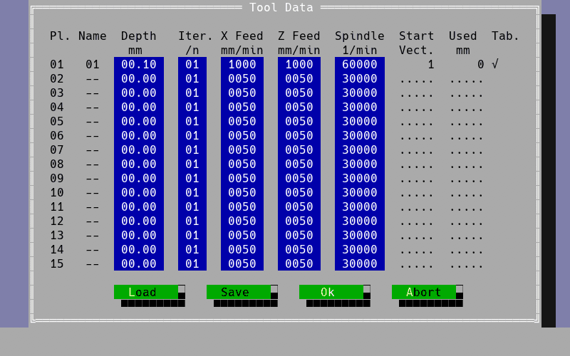
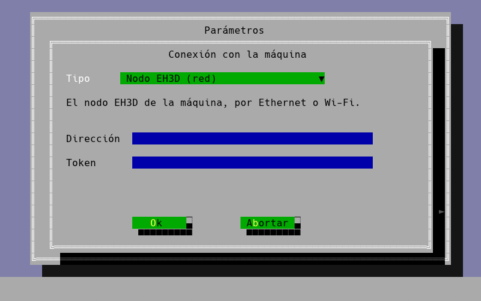

<p align="center">
  
</p>

# 🪚 EH3D-ROUTEPRO

<p align="center">🇺🇸 <b>English</b> | <a href="README_spa.md">🇪🇸 Español</a> | <a href="README_fra.md">🇫🇷 Français</a> | <a href="README_ita.md">🇮🇹 Italiano</a> | <a href="README_deu.md">🇩🇪 Deutsch</a> | <a href="README_zho.md">🇨🇳 中文</a> | <a href="README_jpn.md">🇯🇵 日本語</a> | <a href="README_por.md">🇵🇹 Português</a></p>

### A cross-platform Rust re-implementation of the routing (milling) workflow of the classic DOS software for Bungard CCD machines, from HP-GL plot files, with a text-mode look-alike interface in eight languages

<p align="center">
  
  
  
  
  
</p>

---

**Honesty check - what actually runs today:** a Rust program with an 80x25 text-mode interface that reads HP-GL `.PLT` plot files, the tool table and the machine configuration, plans multi-pass milling paths (rapid move, plunge, cut, lift) and runs them either **against a simulator** (the default) or, when the machine file says so, **on a real machine** through the computer's serial port, a USB serial adapter or the EH3D-NODE-BUNGARD. 53 tests run on a computer. The serial protocol it shares with EH3D-DRILLPRO has been tried on one real Bungard CCD MTC (the reference run of the three axes and the moves of every axis); **a whole routing job has not run on the machine yet**, and the steps per millimetre are only checked against the original's configuration. The screens you get by default are the classic ones of the MS-DOS program, checked cell by cell against the original; `--modern` starts the menu-driven interface instead. They work with the keyboard and the mouse, the window can be maximized (the screen scales from 640x400 up to 1080p and beyond), the configuration and tool table files are edited and saved from the dialogs, and the About button lists the Bungard CCD and CCD/2 machines (MTC supported, ATC not yet). A console version (`routepro-console`) draws the same screens in a terminal, with the keyboard and the mouse and no window system (SSH, a text console, an old PC). The release packages carry the basic configuration, explained line by line, and an `examples` folder from a square to a hundred thousand points. The tool changer of the ATC models is not supported yet.

---

> **Safety and security status:** this program is not a safety system. With a real connection (`connection` in the machine file) **Start moves the machine**: take the tool out, keep a hand on the machine's power switch and be ready to press `Esc`, which stops the job at once and switches the stepper drivers off. The limit switches are watched by the machine's own control unit (it stops an axis at its switch by itself); this software has no emergency stop of its own, and wrong step bytes or speeds can drive the tool into the work or the table or make the motors lose steps. The protocol layer refuses to move anything until it has been armed. The project is independent: it is not made, endorsed or supported by Bungard Elektronik, and product names appear only to say which file formats and machines it is meant to work with.

## 📋 At a glance

| | |
|---|---|
| Version | `0.0.7` |
| Maturity | Scaffolding |
| Tests | 53 |
| Stack | Rust |
| On real hardware | Yes, on one Bungard CCD MTC: the reference run and the moves of every axis; a whole job has not run yet. Without a machine file it runs on the simulator |

**Jump to:** [Overview](#-overview) · [Architecture](#-architecture) · [Quick start](#-quick-start) · [Testing](#-testing) · [Structure](#-repository-structure) · [Related](#-related-projects)

## 🚦 Project status

Each line is one part of this repository and the light says how far it is today. It is written from what the repository can show (tests, builds, runs), not from what is planned.

🟢 Done and verified · 🟡 Works, with known limits · 🟠 Partly done or not verified yet · 🔴 Not done or not working

| Area | State | What it means here |
|---|---|---|
| Software | 🟡 | A Rust program with an 80x25 text-mode screen reads HP-GL plot files, the tool table and the machine file, plans multi-pass milling paths and runs them against a simulator, or on a real machine when the machine file says so; it needs the folder of EH3D-DRILLPRO next to it. |
| Tests | 🟢 | 53 tests pass (`cargo test --workspace`): the HP-GL reader, the path planning and the screens in all eight languages; the protocol is covered by the 228 tests of EH3D-DRILLPRO. |
| HP-GL reader | 🟡 | Only `IN`, `SP`, `PU`, `PD`, `PA` and `PR` are understood; any other command is counted and ignored, never fatal. Tried only with small sample files written for the tests. |
| Path planning | 🟡 | Each path becomes a rapid move, a plunge, the cut and a lift for every pass, with the depth split evenly and the tool always ending at the surface; checked in tests and on the simulator only. |
| Real hardware | 🟠 | The serial protocol it shares with EH3D-DRILLPRO has been tried on one Bungard CCD MTC (the reference run and the moves of every axis); no routing job has run on a machine, and the spindle and vacuum outputs are untried. |
| Safety in use | 🟡 | `Esc` stops the job within a fraction of a second and switches the stepper drivers off, and the machine's own control unit watches the limit switches; the software has no emergency stop of its own. |
| Server connection | 🟠 | With `connection = server` the program sends the job to EH3D-SERVER and follows its progress; this path has only been exercised against the simulator. |
| Ready-made packages | 🟡 | The first release carries packages for Windows, Linux and macOS (Apple silicon and Intel), each with its SHA-256, built by the release workflow. |
| Documentation | 🟢 | README in eight languages and the protocol notes with what is still a hypothesis; the machine-file guide lives in EH3D-DRILLPRO. |

## 🎯 Overview

* The **file readers**: HP-GL `.PLT` plot files (`IN`, `SP`, `PU`, `PD`, `PA`, `PR`; any other command is counted and ignored, never fatal), the tool table `ROUTEPRO.RTD` (depth, passes, feed rates in XY and Z, spindle speed) and the machine configuration `ROUTEPRO.RCF`.
* The **path planner**: each path becomes a rapid move to its start and then, for every pass, a plunge, the cut along the path and a lift; the depth is split evenly across the passes and the tool always ends at the surface.
* The **interface**: an 80x25 text-mode screen with CGA colours, menus, a file dialog and a vector view of the holes, shown in a window. It speaks English, Spanish, Italian, German, French, Portuguese, Chinese and Japanese: choose the language from the menu or start with `--lang`.
* The **machine protocol** (`protocol/`, crate `eh3d-routepro-protocol`): re-exports the protocol library of EH3D-DRILLPRO (byte transport, motion planning, safety gate) and adds the routing plan.
* The **simulator**: the whole job runs to the end without hardware; the tests use it.
* The **machines**: those with a serial-port control unit that ran the DOS software 4.6: Bungard CCD MTC and CCD/2 MTC (manual tool change; the CCD/2 has the smaller table of 325 x 270 mm). The table size and the other machine constants come from the machine's configuration file. It has been tried on a CCD MTC only, and the spindle and vacuum cleaner outputs have not been tried yet. The two ATC models (CCD ATC and CCD/2 ATC, automatic tool change) will get separate applications, built with what the reverse engineering allows. The XL models and the machines made since have a modern control unit and software of their own and are not covered.
* The **machine file** (`machine.cfg`, shared by DRILLPRO and ROUTEPRO): how the job reaches the machine (`demo` simulator, `rs232` the computer's own serial port, `usb` a USB serial adapter or `node` the EH3D-NODE-BUNGARD over the network) and, one value per line, everything tuned on a real machine: search speeds and ramps, the calibration jump, the limits of the motors.
* The **reference run**: Z up to its limit switch, then X and Y, then a smooth calibration jump. The control unit reports "all three axes home" on the RI line, which the program watches; when the machine is parked it skips the searches, moves X and Y 10 mm away from their switches and searches for them again, so it sees them arrive live.
* **Steady motion**: moves go out as one continuous stream whose byte positions carry the time (a USB adapter delivers bytes in bursts otherwise), Z moves byte by byte, and `Esc` cancels a job within a fraction of a second and switches the stepper drivers off.
* The **spindle**: by default the control unit's own (its latch bits, up to 60000 rpm); with `spindle = node` in the machine file the job asks the EH3D-NODE-BUNGARD for it instead (a variable-frequency drive on the node's outputs, any speed up to the node's maximum, stopped on any stop). With a node the programs also read the machine's lamps, so each axis arriving at home is seen live without reading the home line in the middle of the stream.
* The **server connection** (`connection = server` in the machine file, with `server_address`, `server_token` and `server_machine`): instead of driving the machine itself, the program sends the job to the [EH3D-SERVER](https://github.com/JuanenRac/EH3D-SERVER), which plans it with the constants of the machine, runs it through the machine's node, and tells the program how it goes; the program shows the progress and answers the dialogs as usual, `Esc` stops the job on the server, and closing the program does not stop it.
* The **job archives, the Offset window and the simulation**: a job can be packed in a ZIP archive (the Select File window goes inside it, and `routepro JOB.ZIP` loads its first routing file); the arrow next to the file name lists the patterns `*.PLT`, `*.ZIP` and `*.*`; the Load buttons of the tool and configuration windows choose the file to load; on a real machine the Offset window homes it, follows every move of the window and homes it again; and the simulated job takes the time that the machine would take.
* The **sounds**: `sound_finish` and `sound_tool_change` in the machine file are each off (the default), `default` (a tone the program makes) or the path of a WAV file of your own; the first plays when a job ends by itself, the second when the machine asks for a tool.
* The **drawings of a board**: besides HP-GL, a `.DXF` drawing (lines, polylines with arcs, arcs and circles) or the outline layer of a Gerber board (`.GKO`, `.GM1`, `.GML`, or a `.GBR` that calls itself the profile) is loaded as a routing path; the HP-GL arcs, circles and scaling (`AA`, `AR`, `CI`, `SC`, `IP`) are cut into chords by the chord angle of the configuration.
* **Several machines and stations**: with `connection = server`, `routepro --machines` lists every machine of the server, grouped by station, with what each one is doing, its job and the jobs ready (the server answers for all of them at once), and `routepro --machine ID` sends the jobs of this program to that machine instead of the one in the machine file; the machines run at the same time, one job on each.
* **The connection chosen in the Config window:** a drop-down with the five ways the job reaches the machine (the simulator, the serial port, a USB adapter, the EH3D node and the EH3D server) and, under it, what each one needs: a port, an address and a token, a machine of the server; what is chosen is checked, applied with OK and written into the machine file without touching its other lines.
* **A blinking cursor:** the cursor of a numeric or text field being edited blinks (half a second on, half a second off), as on the screens it follows.
* **Tabs for the outside of a panel and jobs that go on:** the closed paths of a panel are cut at its tabs (how many on each side, how wide, where), so the router lifts there and the boards stay joined until they are broken out; a job can leave out the paths already done and go on after a stop.
* **A table that is not flat and spoken notices:** with the height map of the table the cut follows its height in pieces of 10 mm, so the tool keeps the same depth into the board from one end of the table to the other (without a map nothing changes); and the sound of the end of a job and of the tool request can be a voice (`sound_finish = voice:es:f`) from the folder `voices` next to the program, as in EH3D-DRILLPRO.

### 🆚 The original and this version

The original is the closed MS-DOS program of Bungard that routes with the CCD machines. This version is written again from recordings of what the original does (its screens, its files and what it sends to the control unit); no code of the original is in it. What is the same and what is different:

| Aspect | Original (MS-DOS) | This version |
|---|---|---|
| Computer | Only an MS-DOS PC (or an emulator) | Windows, Linux and macOS, 32 and 64 bits; a console version for SSH and old PCs |
| Screens | 80x25 text mode | The same classic screens by default, checked cell by cell against the original, with the mouse and a window that scales from 640x400 to 1080p and beyond; `--modern` offers a menu-driven interface and EH3D-BUNGARD-GUI a graphical one |
| Languages | The language of the program | Eight: English, Spanish, Italian, German, French, Portuguese, Chinese and Japanese, changed from the menu or with `--lang` |
| Panels | Copies of the board on the table | Copies of the board, and the outside of the panel can be routed with tabs (how many on each side, how wide, and where) that hold the boards until they are broken out; a job interrupted in the middle can go on |
| Link to the machine | The computer's serial port to the control unit | The simulator by default; on a real machine the serial port, a USB serial adapter, the EH3D-NODE-BUNGARD over the network or the EH3D-SERVER, chosen from a drop-down in the Config window |
| Extras | None of these | A simulator that runs a whole job, sounds for the end of the job and for a tool request, several machines at once through the server, ZIP job archives, DXF and Gerber outlines, a blinking cursor, and a test suite that runs on every change |
| Source and licence | Closed, proprietary | Open source (GPL-3.0-or-later), written in Rust |
| Maturity | Years of use on real machines | Much younger: the reference run and the moves of every axis have been tried on one real Bungard CCD MTC; a whole job has not run on a machine yet, and the tool changer of the ATC models has not run on a real one |

## 🧩 Role in EH3D

EH3D-ROUTEPRO is the milling sibling of EH3D-DRILLPRO and depends on it by path: the folder `EH3D-DRILLPRO` must sit next to this one. It reuses the serial protocol, the screen and the language support. It does not depend on any other EH3D repository yet. The files of the machine (the drill file, the HP-GL file, the tool tables and the machine configuration) come from the crate `eh3d-bungard-formats` of EH3D-COMMON, which has to be next to it as well.

## 🏛️ Architecture

<p align="center">
  
</p>

How the parts of this repository fit together: who uses it, what it holds and what it depends on. The picture is drawn from `docs/architecture.json` and checked against the code.

## 🖼️ Screenshots

<p align="center">
  
</p>

<p align="center"><em>The main screen of the classic routing program: the scale, the offset and the clip, the vectors of the plot and the buttons.</em></p>

<p align="center">
  
</p>

<p align="center"><em>The tool data: the depth, the passes, the feeds along the path and of the plunge, and the spindle speed of every tool.</em></p>

<p align="center">
  
</p>

<p align="center"><em>The connection with the machine: the way chosen in the drop-down and what it needs (here the EH3D server).</em></p>

## 🚀 Quick start

You need a stable Rust toolchain.

```bash
cargo build --release --features gui
cargo test --workspace
cargo clippy --workspace --all-targets -- -D warnings
cargo fmt --all --check
python -I tools/ci_validate.py
```

Run it with `run.bat` (Windows) or `./run.sh` (Linux and macOS); both build the program first if needed. Both need Rust and the sibling folder `EH3D-DRILLPRO`: `run.bat [FILE.PLT] [--lang en|es|it|de|fr|pt|zh|ja] [--data DIR] [--dump]`. `--data` is the folder with `ROUTEPRO.RTD` and `ROUTEPRO.RCF` (default: `testdata/`) and `--dump` prints the screen as plain text. Keys: `Alt` plus the highlighted letter opens a menu, arrows move, `Enter` accepts, `Esc` goes back; the menu bar can also be clicked. Chinese and Japanese need a CJK font among the system fonts. `--connection FILE` points to another machine file than the default one (`%APPDATA%\EH3D\machine.cfg` on Windows, `~/.config/eh3d/machine.cfg` elsewhere); without a machine file the program runs on the simulator. `--modern` starts the menu-driven interface instead of the classic screens.

## 🧪 Testing

The suite has 53 tests (`cargo test --workspace`). They check the HP-GL reader, the path planning (passes, plunge, cut and lift), the routing plan of the protocol crate, the classic screens cell by cell and the screens in all eight languages. The protocol it reuses (bytes, motion, the safety gate) is tested in EH3D-DRILLPRO. The CI also runs `cargo fmt --check` and `cargo clippy` with warnings as errors, and `python -I tools/ci_validate.py` checks the manifest, the versions, the changelog and the eight READMEs.

## 🏗️ Build & Release

The version lives in `Cargo.toml` and in `eh3d.project.json`, and each version has its entry in [CHANGELOG.md](CHANGELOG.md). Releases are published on GitHub.

**Ready-made packages:** every release carries a package for Windows (zip), Linux (tar.gz) and macOS (Apple silicon and Intel, tar.gz) with the program, the licence and this README, each with its SHA-256 next to it. They are built by the `Release binaries` workflow of this repository. Download one from the Releases page; on Linux the window needs X11 or Wayland.

## 📂 Repository Structure

<p align="center">
  
</p>

<details>
<summary>Text version of the tree</summary>

```text
EH3D-ROUTEPRO/
├── src/
│   ├── job.rs                                   HP-GL paths turned into the routing job
│   ├── app.rs texts.rs                          the application and its texts in eight languages
│   └── bin/                                     the routepro and routepro-console executables
├── protocol/src/
│   ├── route.rs                                 passes, plunge, cut and lift for every path
│   └── lib.rs                                   re-exports the protocol of EH3D-DRILLPRO
├── tests/                                       HP-GL parsing, path planning, the classic screens and the screens in all languages
├── docs/                                        the protocol notes, the classic screens
├── testdata/                                    small sample files written for the tests
├── config/                                      the basic configuration, explained line by line
├── examples/                                    example files, from a square to 100000 points
├── tools/                                       CI check, README check and the picture tools
├── images/                                      banner, the two pictures and the screenshots
├── .github/                                     CI and release workflows, issue and pull-request templates
├── build.sh build.bat                           build and test scripts
├── run.sh run.bat                               start the program
├── eh3d.project.json                            manifest: version, role, maturity and build command
├── Cargo.toml Cargo.lock                        the Rust package and its locked dependencies
├── CHANGELOG.md                                 what changed in each version
├── SECURITY.md SUPPORT.md                       how to report a vulnerability and where to ask
└── CONTRIBUTING.md CODE_OF_CONDUCT.md LICENSE   how to contribute, the code of conduct and the licence
```

</details>

## 🗺️ Roadmap & Known limits

**Known limits today**

* No routing job has run on a real machine yet: the serial protocol it shares with EH3D-DRILLPRO has been tried on one Bungard CCD MTC (the reference run of the three axes and the moves of every axis), the steps per millimetre are only checked against the original's configuration, and the spindle and vacuum outputs are untried.
* Only the HP-GL commands `IN`, `SP`, `PU`, `PD`, `PA` and `PR` are understood; any other command is counted and ignored, never fatal.
* The reader and the planner have only been tried with small sample files written for the tests.
* The program needs the folder of EH3D-DRILLPRO next to it, because it depends on it by path.
* Only the MTC models are supported; the ATC models are not yet and the XL models are not covered. Chinese and Japanese need a CJK font among the system fonts.

**Next**

* Run a routing job on the machine and confirm the steps per millimetre, the spindle and the vacuum outputs.
* Try the HP-GL reader with plot files from real boards.
* Read HP-GL with the shared reader of [EH3D-CORE-LIBS](https://github.com/JuanenRac/EH3D-CORE-LIBS), where it is planned.

## 🌍 Languages

README and texts exist in English, Spanish, French, Italian, German, Chinese, Japanese and European Portuguese.

## 🔗 Related Projects

* [EH3D-DRILLPRO](https://github.com/JuanenRac/EH3D-DRILLPRO): the drilling sibling; this project uses its protocol, screen and languages
* [EH3D-CORE-LIBS](https://github.com/JuanenRac/EH3D-CORE-LIBS): the shared G-code and Excellon readers of the suite; HP-GL is planned there
* [EH3D-COMMON](https://github.com/JuanenRac/EH3D-COMMON): the project container and the machine telemetry types of the suite
* [EH3D-NODE-BUNGARD](https://github.com/JuanenRac/EH3D-NODE-BUNGARD): an ESP32-S3 node (Ethernet or Wi-Fi) that sits in the machine's box, sends the steps out of its own serial port with the timing a USB adapter cannot keep, reads the machine's lamps and drives the spindle's drive; it has its own web panel
* [EH3D-SERVER](https://github.com/JuanenRac/EH3D-SERVER): the center of the EH3D family: it takes the jobs of this program (`connection = server`) and of the other clients, and runs them on the machine through its node

## 📚 Documentation

* [Protocol notes](docs/PROTOCOL.md): what is known about how the control unit is driven (shared with EH3D-DRILLPRO) and what is still a hypothesis.
* [Connection and tuning](https://github.com/JuanenRac/EH3D-DRILLPRO/blob/main/docs/CONNECTION.md): the machine file, the three connections and every value
* [The classic screens](docs/CLASSIC.md): how the screens of the MS-DOS program are reproduced and checked
* [Changelog](CHANGELOG.md)

## 🤝 Contributing & Community

* Before a pull request run `cargo fmt --all --check`, `cargo clippy --workspace --all-targets -- -D warnings`, `cargo test --workspace` and `python -I tools/ci_validate.py`: all must pass. See [CONTRIBUTING.md](CONTRIBUTING.md) and the [code of conduct](CODE_OF_CONDUCT.md).
* The README exists in eight languages: a change to the text is made in all eight files, and the two pictures are drawn from `docs/architecture.json` and `docs/structure.json` by `tools/make_architecture.py` and `tools/make_structure.py`.
* Do not describe as working on a machine what has only been tried on the simulator.
* Report a vulnerability privately: [SECURITY.md](SECURITY.md). Questions, ideas and reports: electrohobby3d@gmail.com ([SUPPORT.md](SUPPORT.md)).

## 👤 AUTHOR

**JuanenRac (Electro Hobby 3D)** · electrohobby3d@gmail.com

## 📜 LICENSE

Software: GPL-3.0-or-later. See [LICENSE](LICENSE). Hardware designs of the suite use CERN OHL-S.
