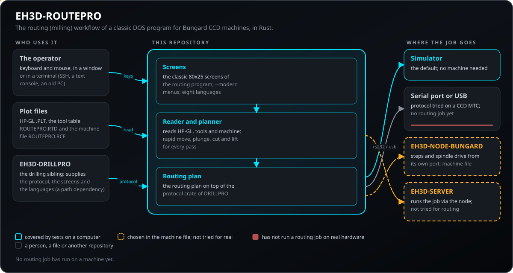
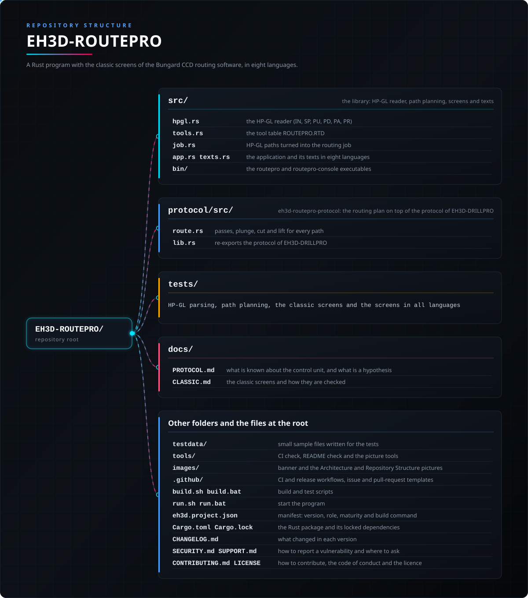

<p align="center">
  
</p>

# 🪚 EH3D-ROUTEPRO

<p align="center"><a href="README.md">🇺🇸 English</a> | <a href="README_spa.md">🇪🇸 Español</a> | <a href="README_fra.md">🇫🇷 Français</a> | <a href="README_ita.md">🇮🇹 Italiano</a> | <a href="README_deu.md">🇩🇪 Deutsch</a> | <a href="README_zho.md">🇨🇳 中文</a> | <a href="README_jpn.md">🇯🇵 日本語</a> | 🇵🇹 <b>Português</b></p>

### Uma reimplementação multiplataforma em Rust do fluxo de fresagem do clássico software DOS das máquinas Bungard CCD, a partir de ficheiros de traçado HP-GL, com uma interface em modo de texto semelhante à original, em oito idiomas

<p align="center">
  
  
  
  
  
</p>

---

**Verificação de honestidade - o que funciona hoje:** um programa em Rust com interface de texto de 80x25 que lê ficheiros de traçado HP-GL `.PLT`, a tabela de ferramentas e a configuração da máquina, planeia trajetórias de fresagem de várias passagens (avanço rápido, penetração, corte, elevação) e executa-as **contra um simulador** (por omissão) ou, quando o ficheiro da máquina o indica, **numa máquina real** pela porta série do computador, um adaptador USB-série ou o EH3D-NODE-BUNGARD. 47 testes correm num computador. O protocolo série que partilha com o EH3D-DRILLPRO foi experimentado numa Bungard CCD MTC real (a referência dos três eixos e os movimentos de cada eixo); **um trabalho de fresagem completo ainda não correu na máquina**, e os passos por milímetro só foram confrontados com a configuração do original. Por predefinição, aparecem os ecrãs clássicos do programa MS-DOS, verificados célula a célula com o original; `--modern` inicia a interface de menus. Funcionam com teclado e rato, a janela pode ser maximizada (o ecrã ajusta-se de 640x400 a 1080p e mais), os ficheiros de configuração e de ferramentas editam-se e gravam-se nos diálogos, e o botão Sobre indica as máquinas Bungard CCD e CCD/2 (MTC suportadas, ATC ainda não). Uma versão de consola (`routepro-console`) desenha os mesmos ecrãs num terminal, com teclado e rato e sem sistema de janelas (SSH, consola de texto, um PC antigo). Os pacotes de cada versão incluem a configuração básica, explicada linha a linha, e uma pasta `examples` desde um quadrado até cem mil pontos. O trocador de ferramenta dos modelos ATC ainda não é suportado.

---

> **Estado de segurança (safety) e de segurança informática:** este programa não é um sistema de segurança. Com uma ligação real (`connection` no ficheiro da máquina) **Iniciar move a máquina**: retire a ferramenta, mantenha uma mão no interruptor da máquina e tenha pronta a tecla `Esc`, que pára o trabalho de imediato e desliga os drivers dos motores. Os fins de curso são vigiados pela própria unidade de controlo da máquina (pára o eixo no seu fim de curso por si só); este software não tem paragem de emergência própria, e bytes de passo ou velocidades errados podem levar a ferramenta contra a peça ou a mesa ou fazer os motores perderem passos. A camada de protocolo recusa-se a mover o que quer que seja até ser armada. O projeto é independente: não é fabricado, apoiado nem suportado pela Bungard Elektronik, e os nomes de produtos aparecem apenas para dizer com que formatos de ficheiro e máquinas deve funcionar.

## 📋 Num relance

| | |
|---|---|
| Versão | `0.0.3` |
| Maturidade | Estrutura inicial |
| Testes | 47 |
| Tecnologias | Rust |
| Em hardware real | Sim, numa Bungard CCD MTC: a referência e os movimentos de cada eixo; um trabalho completo ainda não correu. Sem ficheiro da máquina corre no simulador |

**Ir para:** [Visão geral](#-visão-geral) · [Arquitetura](#-arquitetura) · [Início rápido](#-início-rápido) · [Testes](#-testes) · [Estrutura](#-estrutura-do-repositório) · [Relacionados](#-projetos-relacionados)

## 🚦 Estado do projeto

Cada linha é uma parte deste repositório e a luz diz até onde chega hoje. É escrita com o que o repositório consegue demonstrar (testes, compilações, execuções), não com o que está previsto.

🟢 Feito e verificado · 🟡 Funciona, com limites conhecidos · 🟠 Feito a meio ou ainda por verificar · 🔴 Por fazer ou a não funcionar

| Área | Estado | O que significa aqui |
|---|---|---|
| Software | 🟡 | Um programa Rust com ecrã de texto de 80x25 lê ficheiros de traçado HP-GL, a tabela de ferramentas e o ficheiro da máquina, planeia trajetos de fresagem de várias passagens e executa-os num simulador, ou numa máquina real se o ficheiro da máquina o indicar; precisa da pasta do EH3D-DRILLPRO ao lado. |
| Testes | 🟢 | Passam 47 testes (`cargo test --workspace`): o leitor de HP-GL, o planeamento de trajetos e os ecrãs nos oito idiomas; o protocolo é coberto pelos 202 testes do EH3D-DRILLPRO. |
| Leitor de HP-GL | 🟡 | Só se entendem `IN`, `SP`, `PU`, `PD`, `PA` e `PR`; qualquer outro comando é contado e ignorado, nunca é fatal. Experimentado só com pequenos ficheiros de exemplo escritos para os testes. |
| Planeamento de trajetos | 🟡 | Cada trajeto torna-se, em cada passagem, um movimento rápido, uma penetração, o corte e uma elevação, com a profundidade repartida por igual e a ferramenta a terminar sempre à superfície; verificado só em testes e no simulador. |
| Hardware real | 🟠 | O protocolo série que partilha com o EH3D-DRILLPRO foi experimentado numa Bungard CCD MTC (o movimento de referência e os movimentos de cada eixo); nenhum trabalho de fresagem correu numa máquina, e as saídas do fuso e do aspirador não foram experimentadas. |
| Segurança de utilização | 🟡 | `Esc` pára o trabalho numa fração de segundo e desliga os drivers dos motores, e a própria unidade de controlo da máquina vigia os fins de curso; o software não tem paragem de emergência própria. |
| Ligação ao servidor | 🟠 | Com `connection = server` o programa envia o trabalho ao EH3D-SERVER e acompanha o progresso; este caminho só foi exercitado contra o simulador. |
| Pacotes prontos a usar | 🟡 | A primeira versão publicada traz pacotes para Windows, Linux e macOS (Apple silicon e Intel), cada um com o seu SHA-256, construídos pelo fluxo de publicação. |
| Documentação | 🟢 | README em oito idiomas e as notas do protocolo com o que ainda é hipótese; o guia do ficheiro da máquina está no EH3D-DRILLPRO. |

## 🎯 Visão geral

* Os **leitores de ficheiros**: ficheiros de traçado HP-GL `.PLT` (`IN`, `SP`, `PU`, `PD`, `PA`, `PR`; qualquer outro comando é contado e ignorado, nunca é fatal), a tabela de ferramentas `ROUTEPRO.RTD` (profundidade, passagens, avanços em XY e Z, velocidade do fuso) e a configuração da máquina `ROUTEPRO.RCF`.
* O **planeador de trajetos**: cada trajeto torna-se um movimento rápido até ao início e, em cada passagem, uma penetração, o corte ao longo do trajeto e uma elevação; a profundidade reparte-se por igual pelas passagens e a ferramenta termina sempre à superfície.
* A **interface**: um ecrã em modo de texto de 80x25 com cores CGA, menus, uma caixa de diálogo de ficheiros e uma vista vetorial dos furos, mostrada numa janela. Fala inglês, espanhol, italiano, alemão, francês, português, chinês e japonês: escolha o idioma no menu ou arranque com `--lang`.
* O **protocolo da máquina** (`protocol/`, crate `eh3d-routepro-protocol`): reexporta a biblioteca de protocolo do EH3D-DRILLPRO (transporte de bytes, planeamento de movimento, barreira de segurança) e acrescenta o plano de fresagem.
* O **simulador**: o trabalho completo corre até ao fim sem hardware; os testes usam-no.
* As **máquinas**: as que têm uma unidade de controlo por porta série que usava o software MS-DOS 4.6: Bungard CCD MTC e CCD/2 MTC (troca de ferramenta manual; a CCD/2 tem a mesa mais pequena de 325 x 270 mm). O tamanho da mesa e as restantes constantes vêm do ficheiro de configuração da máquina. Só foi experimentado numa CCD MTC, e as saídas do eixo-árvore (broca) e da ativação do aspirador ainda não foram experimentadas. Os dois modelos ATC (CCD ATC e CCD/2 ATC, troca automática) terão aplicações separadas, feitas com o que a engenharia inversa permitir. Os modelos XL e as máquinas posteriores têm unidade de controlo e software modernos próprios e não estão abrangidos.
* O **ficheiro da máquina** (`machine.cfg`, partilhado pelo DRILLPRO e pelo ROUTEPRO): como o trabalho chega à máquina (`demo` simulador, `rs232` a porta série do próprio computador, `usb` um adaptador USB-série ou `node` o EH3D-NODE-BUNGARD pela rede) e, um valor por linha, tudo o que foi afinado numa máquina real: velocidades e rampas de procura, o salto de calibração, os limites dos motores.
* A **referência**: Z sobe até ao fim de curso, depois X e Y, e por fim um salto de calibração suave. A unidade de controlo indica «os três eixos em origem» pela linha RI, que o programa vigia; com a máquina estacionada, salta as procuras, afasta X e Y 10 mm dos fins de curso e procura-os de novo, assim vê-los chegar em direto.
* **Movimento estável**: os movimentos saem como um único fluxo contínuo cujas posições de byte levam o tempo (senão um adaptador USB entrega os bytes em rajadas), Z move-se byte a byte, e `Esc` cancela um trabalho numa fração de segundo e desliga os drivers dos motores.
* O **eixo-árvore**: por omissão o da própria unidade de controlo (os seus bits de latch, até 60000 rpm); com `spindle = node` no ficheiro da máquina o trabalho pede-o ao EH3D-NODE-BUNGARD (um variador de frequência nas saídas do nó, qualquer velocidade até ao máximo do nó, parado em qualquer paragem). Com um nó, os programas leem também os LED da máquina, de modo que cada eixo que chega a casa é visto em direto sem ler a linha de home a meio do fluxo.
* A **ligação ao servidor** (`connection = server` no ficheiro da máquina, com `server_address`, `server_token` e `server_machine`): em vez de conduzir ele próprio a máquina, o programa envia o trabalho ao [EH3D-SERVER](https://github.com/JuanenRac/EH3D-SERVER), que o planeia com as constantes da máquina, o executa através do nó da máquina e diz ao programa como vai; o programa mostra o progresso e responde aos diálogos como sempre, `Esc` pára o trabalho no servidor, e fechar o programa não o pára.

## 🧩 Papel no EH3D

O EH3D-ROUTEPRO é o irmão de fresagem do EH3D-DRILLPRO e depende dele por caminho: a pasta `EH3D-DRILLPRO` tem de estar ao lado desta. Reutiliza o protocolo série, o ecrã e o suporte de idiomas. Ainda não depende de nenhum outro repositório EH3D.

## 🏛️ Arquitetura

<p align="center">
  
</p>

Como as partes deste repositório se encaixam: quem o usa, o que contém e de que depende. A imagem é desenhada a partir de `docs/architecture.json` e verificada com o código.

## 🚀 Início rápido

É preciso uma cadeia de ferramentas Rust estável.

```bash
cargo build --release --features gui
cargo test --workspace
cargo clippy --workspace --all-targets -- -D warnings
cargo fmt --all --check
python -I tools/ci_validate.py
```

Execute-o com `run.bat` (Windows) ou `./run.sh` (Linux e macOS); ambos compilam primeiro o programa, se for preciso. Os dois precisam de Rust e da pasta irmã `EH3D-DRILLPRO`: `run.bat [FICHEIRO.PLT] [--lang en|es|it|de|fr|pt|zh|ja] [--data DIR] [--dump]`. `--data` é a pasta com `ROUTEPRO.RTD` e `ROUTEPRO.RCF` (por omissão: `testdata/`) e `--dump` imprime o ecrã como texto simples. Teclas: `Alt` mais a letra realçada abre um menu, as setas movem, `Enter` aceita, `Esc` volta atrás; a barra de menus também se pode clicar. O chinês e o japonês precisam de um tipo de letra CJK entre os do sistema. `--connection FILE` indica outro ficheiro de máquina que não o predefinido (`%APPDATA%\EH3D\machine.cfg` no Windows, `~/.config/eh3d/machine.cfg` nos restantes); sem ficheiro de máquina o programa corre no simulador. `--modern` inicia a interface de menus em vez dos ecrãs clássicos.

## 🧪 Testes

A suite tem 47 testes (`cargo test --workspace`). Verificam o leitor HP-GL, o planeamento de trajetos (passagens, mergulho, corte e elevação), o plano de fresagem do crate do protocolo, os ecrãs clássicos célula a célula e os ecrãs nos oito idiomas. O protocolo que reutiliza (bytes, movimento, barreira de segurança) é testado no EH3D-DRILLPRO. A CI também executa `cargo fmt --check` e `cargo clippy` com os avisos como erros, e `python -I tools/ci_validate.py` verifica o manifesto, as versões, o registo de alterações e os oito README.

## 🏗️ Compilação e publicação

A versão está em `Cargo.toml` e em `eh3d.project.json`, e cada versão tem a sua entrada em [CHANGELOG.md](CHANGELOG.md). As versões são publicadas no GitHub.

**Pacotes já compilados:** cada versão publicada inclui um pacote para Windows (zip), Linux (tar.gz) e macOS (Apple silicon e Intel, tar.gz) com o programa, a licença e este README, cada um com o seu SHA-256 ao lado. São construídos pelo workflow `Release binaries` deste repositório. Descarregue um a partir da página de Releases; no Linux, a janela precisa de X11 ou Wayland.

## 📂 Estrutura do repositório

<p align="center">
  
</p>

<details>
<summary>Versão em texto da árvore</summary>

```text
EH3D-ROUTEPRO/
├── src/
│   ├── hpgl.rs                                  o leitor HP-GL (IN, SP, PU, PD, PA, PR)
│   ├── tools.rs                                 a tabela de ferramentas ROUTEPRO.RTD
│   ├── job.rs                                   os trajetos HP-GL convertidos no trabalho de fresagem
│   ├── app.rs texts.rs                          a aplicação e os seus textos em oito idiomas
│   └── bin/                                     os executáveis routepro e routepro-console
├── protocol/src/
│   ├── route.rs                                 passagens, mergulho, corte e elevação de cada trajeto
│   └── lib.rs                                   reexporta o protocolo do EH3D-DRILLPRO
├── tests/                                       leitura de HP-GL, planeamento de trajetos, ecrãs clássicos e ecrãs em todos os idiomas
├── docs/                                        as notas do protocolo, os ecrãs clássicos
├── testdata/                                    pequenos ficheiros de exemplo escritos para os testes
├── config/                                      a configuração básica, explicada linha a linha
├── examples/                                    exemplos, de um quadrado a 100000 pontos
├── tools/                                       verificação de CI, do README e ferramentas de imagens
├── images/                                      banner e as imagens de Arquitetura e Estrutura do repositório
├── .github/                                     fluxos de CI e de publicação, modelos de issues e pull requests
├── build.sh build.bat                           scripts de compilação e testes
├── run.sh run.bat                               arrancam o programa
├── eh3d.project.json                            manifesto: versão, papel, maturidade e comando de compilação
├── Cargo.toml Cargo.lock                        o pacote Rust e as suas dependências fixadas
├── CHANGELOG.md                                 o que mudou em cada versão
├── SECURITY.md SUPPORT.md                       como comunicar uma vulnerabilidade e onde perguntar
└── CONTRIBUTING.md CODE_OF_CONDUCT.md LICENSE   como contribuir, o código de conduta e a licença
```

</details>

## 🗺️ Roteiro e limites conhecidos

**Limites conhecidos hoje**

* Ainda não correu nenhum trabalho de fresagem numa máquina real: o protocolo série que partilha com o EH3D-DRILLPRO foi experimentado numa Bungard CCD MTC (a referência dos três eixos e os movimentos de cada eixo), os passos por milímetro só estão verificados contra a configuração do original e as saídas do fuso e do aspirador não foram experimentadas.
* Só são entendidos os comandos HP-GL `IN`, `SP`, `PU`, `PD`, `PA` e `PR`; qualquer outro comando é contado e ignorado, nunca é fatal.
* O leitor e o planeador só foram experimentados com pequenos ficheiros de exemplo escritos para os testes.
* O programa precisa da pasta do EH3D-DRILLPRO ao seu lado, porque depende dela por caminho.
* Só são suportados os modelos MTC; os modelos ATC ainda não e os modelos XL não estão cobertos. O chinês e o japonês precisam de um tipo de letra CJK entre os do sistema.

**A seguir**

* Executar um trabalho de fresagem na máquina e confirmar os passos por milímetro, o fuso e as saídas do aspirador.
* Experimentar o leitor HP-GL com ficheiros de traçado de placas reais.
* Ler HP-GL com o leitor partilhado do [EH3D-CORE-LIBS](https://github.com/JuanenRac/EH3D-CORE-LIBS), onde está previsto.

## 🌍 Idiomas

O README e os textos existem em inglês, espanhol, francês, italiano, alemão, chinês, japonês e português europeu.

## 🔗 Projetos relacionados

* [EH3D-DRILLPRO](https://github.com/JuanenRac/EH3D-DRILLPRO): o irmão de furação; este projeto usa o seu protocolo, o seu ecrã e os seus idiomas
* [EH3D-CORE-LIBS](https://github.com/JuanenRac/EH3D-CORE-LIBS): os leitores de G-code e Excellon partilhados da suite; o HP-GL está previsto lá
* [EH3D-COMMON](https://github.com/JuanenRac/EH3D-COMMON): o contentor de projeto e os tipos de telemetria de máquina da suite
* [EH3D-NODE-BUNGARD](https://github.com/JuanenRac/EH3D-NODE-BUNGARD): um nó ESP32-S3 (Ethernet ou Wi-Fi) que fica na caixa da máquina, envia os passos pela sua própria porta série com a temporização que um adaptador USB não consegue manter, lê os LED da máquina e comanda o variador do eixo-árvore; tem o seu próprio painel web
* [EH3D-SERVER](https://github.com/JuanenRac/EH3D-SERVER): o centro da família EH3D: recebe os trabalhos deste programa (`connection = server`) e dos outros clientes, e executa-os na máquina através do seu nó

## 📚 Documentação

* [Notas do protocolo](docs/PROTOCOL.md): o que se sabe sobre como a unidade de controlo é comandada (partilhado com o EH3D-DRILLPRO) e o que continua a ser uma hipótese.
* [Ligação e afinação](https://github.com/JuanenRac/EH3D-DRILLPRO/blob/main/docs/CONNECTION.md): o ficheiro da máquina, as três ligações e cada valor
* [Os ecrãs clássicos](docs/CLASSIC.md): como os ecrãs do programa de MS-DOS são reproduzidos e verificados
* [Registo de alterações](CHANGELOG.md)

## 🤝 Contribuir e comunidade

* Antes de uma pull request execute `cargo fmt --all --check`, `cargo clippy --workspace --all-targets -- -D warnings`, `cargo test --workspace` e `python -I tools/ci_validate.py`: tudo tem de passar. Consulte [CONTRIBUTING.md](CONTRIBUTING.md) e o [código de conduta](CODE_OF_CONDUCT.md).
* O README existe em oito idiomas: uma alteração ao texto faz-se nos oito ficheiros, e as duas imagens são desenhadas a partir de `docs/architecture.json` e `docs/structure.json` com `tools/make_architecture.py` e `tools/make_structure.py`.
* Não descreva como a funcionar numa máquina o que só foi experimentado no simulador.
* Comunique uma vulnerabilidade em privado: [SECURITY.md](SECURITY.md). Perguntas, ideias e relatórios: electrohobby3d@gmail.com ([SUPPORT.md](SUPPORT.md)).

## 👤 AUTOR

**JuanenRac (Electro Hobby 3D)** · electrohobby3d@gmail.com

## 📜 LICENÇA

Software: GPL-3.0-or-later. Ver [LICENSE](LICENSE). Os projetos de hardware da suite usam a CERN OHL-S.
